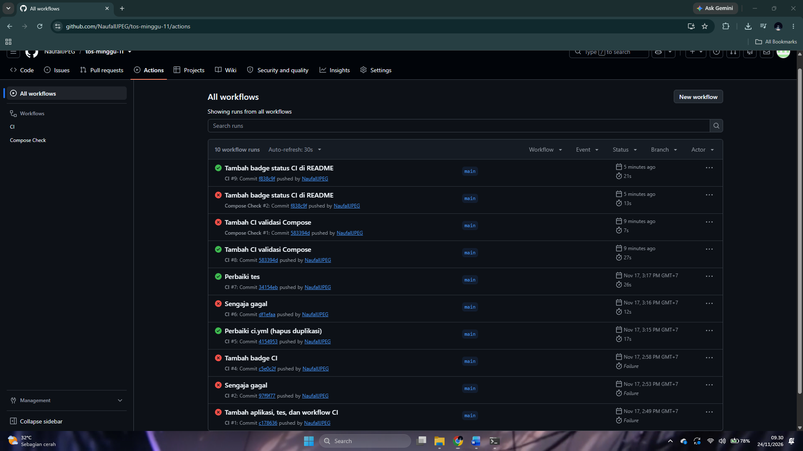
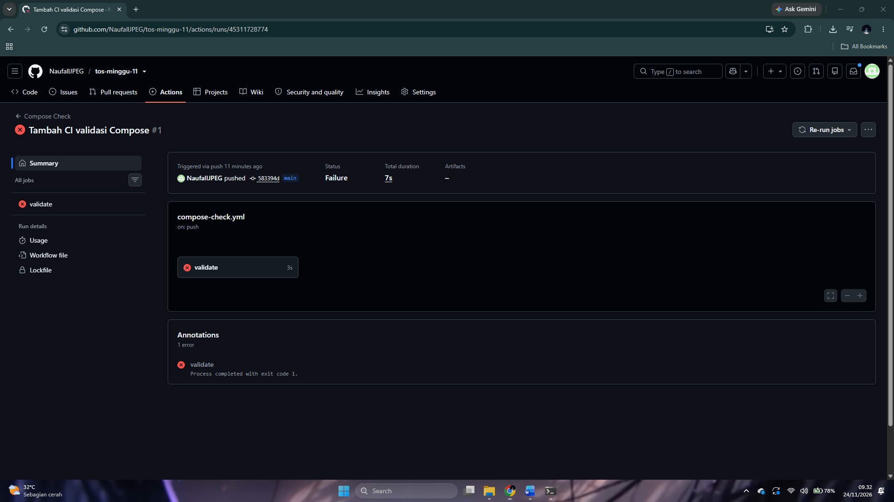
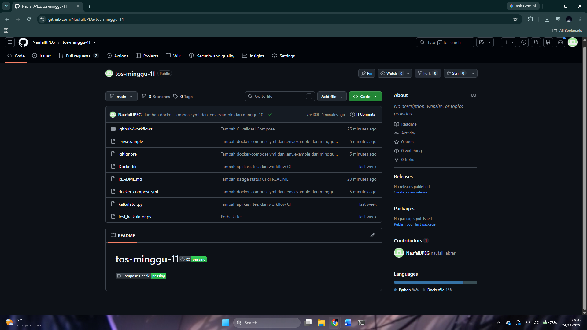

# Tugas Minggu 11: CI untuk Repo Compose

**Nama:** Muhammad Naufal Abrar Saputra
**NIM:** 202557201071
**Mata kuliah:** Teknologi Open Source

## Deskripsi
Workflow ini memvalidasi sintaks file docker-compose.yml (stack WordPress + MariaDB) memakai `docker compose config -q`. Workflow berjalan otomatis setiap ada push ke branch main dan setiap ada Pull Request.

## Isi repositori
- .github/workflows/compose-check.yml : workflow CI
- docker-compose.yml : stack WordPress + MariaDB (tugas minggu 10)
- .env.example : contoh variabel lingkungan tanpa rahasia asli
- .gitignore : mengabaikan .env

## Cara kerja workflow
Pemicunya adalah push ke branch main dan pull_request. Workflow punya satu job bernama validate yang berjalan di runner ubuntu-latest. Job ini punya tiga step: (1) actions/checkout mengunduh isi repo ke runner, (2) `cp .env.example .env` membuat file .env dari contoh karena .env asli tidak ada di repo, dan (3) `docker compose config -q` memeriksa sintaks file Compose tanpa menjalankan container. Ada juga step bonus yang menjalankan `docker compose up -d`, `ps`, lalu `down -v`.

## Bukti
1. Run hijau di tab Actions
   
2. Pull Request dengan check gagal (merah)
   
3. Badge status di README
   

Tautan Pull Request (sudah hijau dan di-merge): [TEMPEL TAUTAN PR]

## Kendala dan cara mengatasinya
1. Badge Compose Check sempat merah (failing) setelah workflow dipasang. Penyebabnya repo belum berisi docker-compose.yml dan .env.example, sehingga step `docker compose config -q` gagal. Solusinya menyalin docker-compose.yml dari tugas minggu 10 dan membuat .env.example.
2. Password database ternyata tertulis langsung di docker-compose.yml. Solusinya mengganti nilainya dengan variabel `${DB_PASSWORD}` dan `${DB_ROOT_PASSWORD}`, lalu menaruh nilai contoh di .env.example. File .env asli tidak ikut ke repo karena diabaikan .gitignore.
3. Nama branch uji-gagal sudah terpakai oleh proyek sebelumnya, jadi PR uji memakai nama uji-gagal-compose.

## Refleksi singkat
Dengan CI, kesalahan seperti indentasi YAML yang rusak ketahuan otomatis sebelum digabung ke main, tanpa menunggu saya menjalankan perintah secara manual. PR yang merah lalu hijau menunjukkan CI berfungsi sebagai penjaga kualitas. Pola ini bisa dipakai di tugas atau proyek lain agar hasil kerja lebih rapi dan aman.
